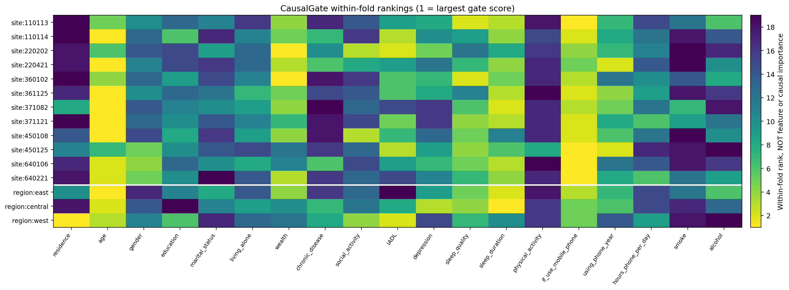
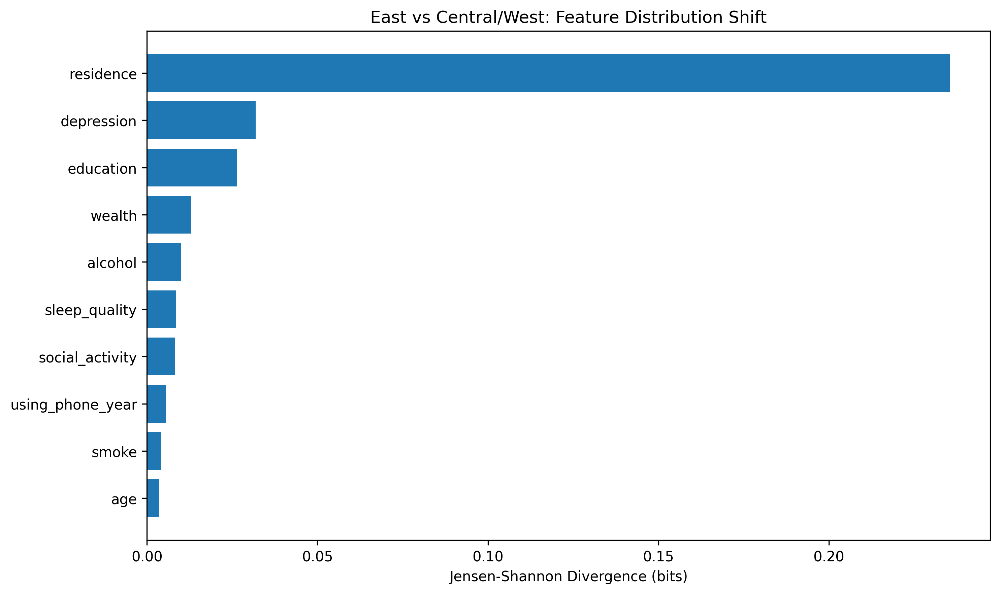
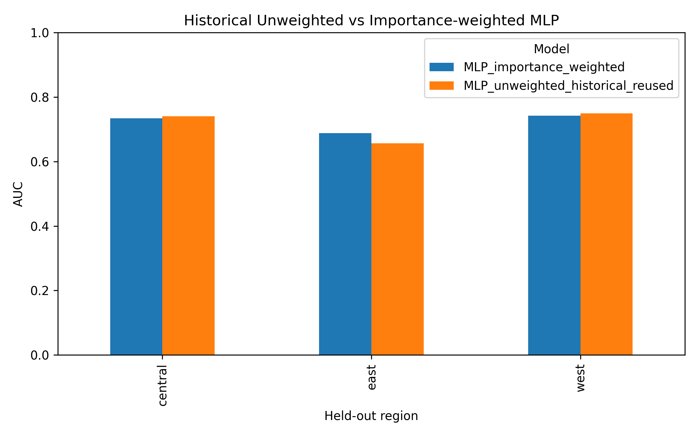
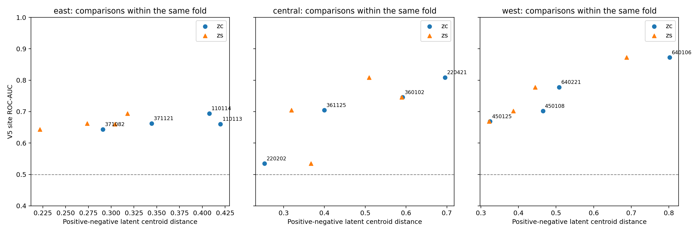
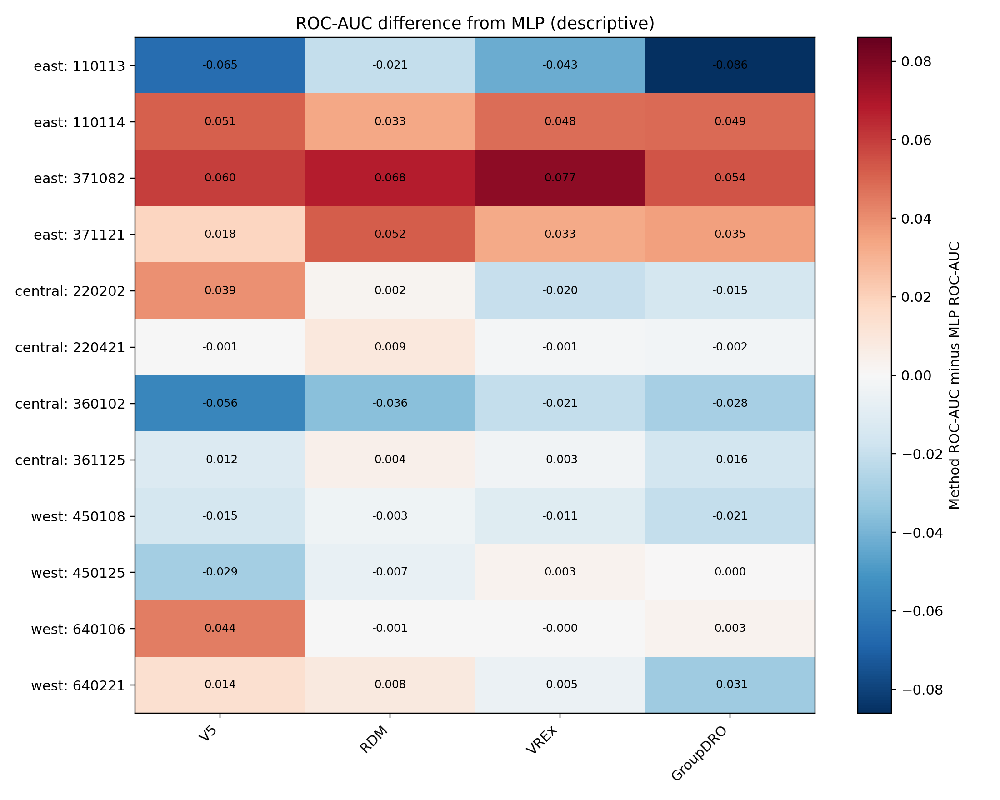
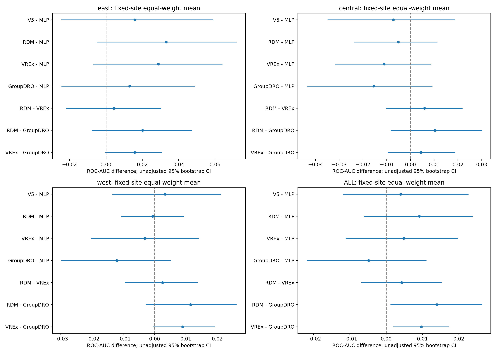
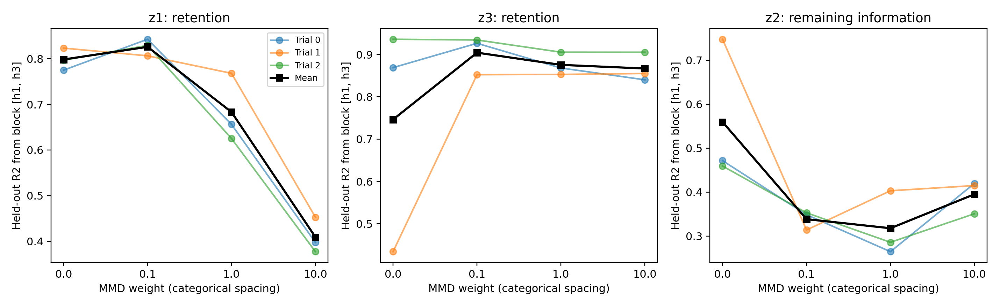
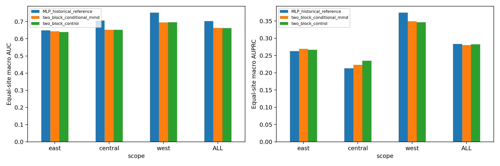
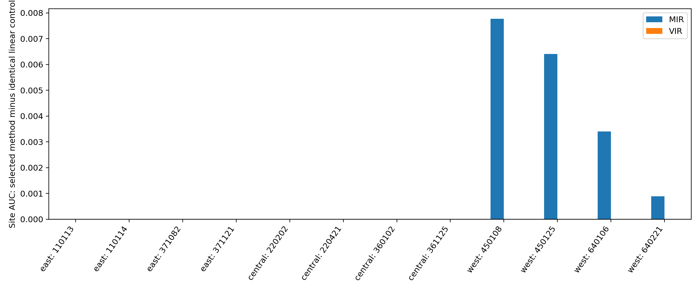

# 实验2611：跨地区预测稳定性与因果解耦阶段成果

## 任务一：门控到底选出了什么

### 1. 工作流程

1. 提取19个特征的门控权重，检查是否过于一致，并画完整色阶、局部放大热力图。
2. 比较留出站点和留出地区时的门控排序，检查前五特征重合情况。
3. 检查不同展示阈值对“选中数量”的影响。
4. 通过特征扰动、分支预测及门控与贡献对照，检查高门控是否真的对应较高预测贡献。

	主要结果目录：`gate_step1`、`gate_step2`、`gate_step3`、`task1_step4_gate_alignment`；均位于`outputs/analysis_2611/`。

### 2. 结果与解释

	三个留出地区中，门控均值约0.47，标准差约0.021～0.039，最大值均未达到0.6。权重存在差异，但没有形成非常明确的“强选中/强排除”。

| 稳定性指标                | 留出站点 | 留出地区 |
| ------------------------- | -------: | -------: |
| 平均Spearman排名相关      |   0.5878 |   0.2234 |
| 前五特征平均Jaccard重合度 |   0.5089 |   0.3889 |

	留出不同地区时，共同进入前五的只有年龄和是否使用智能手机。没有找到3～5个在所有地区都权重极高的变量。

[	门控与贡献对照表](../outputs/analysis_2611/task1_step4_gate_alignment/任务1_第4步_相关性汇总.csv)中，测试集联合预测头的门控与AUC下降相关系数，东、中、西分别约0.465、0.123、0.253，关系并不一致。

	基于以上发现，后续可能还需要进一步的实验研究模型是否真正具备区分因果特征的能力。

## 任务二：东部地区效果较差的原因

### 1. 输入分布、阳性率与站点差异

	已完成输入分布比较、地区分类诊断、缺失情况比较、站点异质性分析、特征依赖分析及候选特征组删除实验。

对应目录：

- `experiment1_input_shift`：地区特征分布和地区可区分性。
- `experiment2_site_heterogeneity`：站点输入差异与预测表现的关系。
- `experiment3_feature_reliance`：各站点特征扰动、排名和依赖稳定性。
- `experiment4_candidate_feature_ablation`：删除候选特征组后重新训练的对照。

	东部阳性率并非三个地区中最低，中部才最低。因此不能用“东部阳性率最低”解释东部表现。地区平均表现还会掩盖站点之间的差异。

### 2. 调整输入分布是否有帮助

	使用交叉拟合的地区分类器估计样本权重，比较加权MLP与历史未加权MLP。模型选择使用来源验证集。

| 留出地区 | 未加权地区整体AUC | 加权后AUC |     差值 |
| -------- | ----------------: | --------: | -------: |
| 东部     |           0.65634 |   0.68821 | +0.03186 |
| 中部     |           0.74066 |   0.73443 | -0.00623 |
| 西部     |           0.74946 |   0.74248 | -0.00698 |

	东部AUPRC由0.26068升至0.31773。中西部没有一致改善。

	随后在`experiment1c_prediction_diagnostics`检查预测概率、来源验证集阈值与抽样区间。加权模型在东部使用固定0.5阈值时未识别出阳性，但AUC上升，说明“排序”和“阈值分类结果”必须分别解释；不能仅据一个阈值宣布模型有效或无效。

### 3. 特征组删除对照

	删除抑郁/睡眠、IADL、手机使用组和社会经济背景组后，在相同设置下重新训练，并与该轮完整特征模型比较。

[跨地区汇总](../outputs/analysis_2611/experiment4_candidate_feature_ablation/cross_region_ablation_summary.csv)显示：

- MLP删除社会经济背景组后，三个地区AUC均提高，平均约+0.02663。
- V5删除同一组后，平均AUC约-0.00169，地区之间方向不同。
- V5删除手机组后，平均AUC约-0.02203；MLP约-0.00781，且不同地区变化并不一致。

  这说明模型对特征的依赖不同，有些信息可能在特定训练设置下带来不稳定关联。

### 4. 阶段回答

	输入分布调整能改善本轮东部预测，但不能解释全部地区表现。应同时考虑特征依赖、概率偏移、模型训练及站点异质性。下一轮若验证加权收益，应明确其目标域适配设置，并增加有限的重复训练。

## 任务三：进一步分析失败案例与低维解耦问题

### 1. 已完成的诊断

| 步骤  | 主要问题                             | 结果目录                                      |
| ----- | ------------------------------------ | --------------------------------------------- |
| 第1步 | 同样低阳性率，为什么站点表现不同     | `task3_step1_site_failure_diagnostics`      |
| 第2步 | 两条隐藏表示是否异常，信息是否集中   | `task3_step2_v5_representation_diagnostics` |
| 第3步 | 固定表示后换简单读出器，能否改善预测 | `task3_step3_fixed_representation_probes`   |
| 第4步 | 特征与标签的关联能否跨站点迁移       | `task3_step4_feature_association_transfer`  |
| 第5步 | 哪些特征推动正负样本得分差           | `task3_step5_linear_score_contributions`    |
| 第6步 | 单站点现象能否扩展到全部12个站点     | `task3_step6_global_diagnostics`            |

### 2. 失败不能只用低阳性率解释

	220202与360102被用于低阳性率站点对照。在固定模型的探索性抽样比较中，MLP两站点AUC差约0.306，区间约[0.127, 0.480]；V5差约0.211，区间约[-0.002, 0.414]。

	低阳性率会导致阳性样本少、估计不稳定，并影响AUPRC基线，但不会在数学上直接决定AUC一定差。

### 3. 表示诊断和探针结果

	目标站点上，V5的预测相关分支zc有效维度均值约4.83，另一分支zs约8.34；两条分支并非所有维度都完全失活。

	固定表示探针中，220202的zc相对原始19维输入AUC差约+0.00415，区间跨0；360102约-0.04807，区间也跨0。其他表示空间的比较同样没有形成稳定、清晰的优势。

### 4. 从单站点返回全局

| 模型     | 东部站点宏AUC | 中部站点宏AUC | 西部站点宏AUC | 全部12站点宏AUC |
| -------- | ------------: | ------------: | ------------: | --------------: |
| MLP      |       0.64927 |       0.70571 |       0.75183 |         0.70227 |
| V5       |       0.66519 |       0.69849 |       0.75517 |         0.70628 |
| RDM      |       0.68240 |       0.70055 |       0.75124 |         0.71140 |
| VREx     |       0.67804 |       0.69461 |       0.74869 |         0.70711 |
| GroupDRO |       0.66229 |       0.69024 |       0.73974 |         0.69742 |

	模型收益具有地区和站点差异；不能挑选单个改善最大的站点概括整体性能。

### 5. 阶段回答

	没有证据证明“低维、有明确含义的特征必然导致复杂表示解耦失败”，也尚未建立表示崩溃导致失败的因果链。真实数据中的双块解耦筛选未产生明显收益，详见任务五。

## 任务四：RDM、VREx和GroupDRO的应用效果为何不同？

### 1. 差异是否可靠

	`task4_step1_algorithm_comparison_uncertainty`复核历史预测并计算配对差异区间。总体站点宏AUC中RDM约0.71140、VREx约0.70711、GroupDRO约0.69742。

### 2. 概率调整

	`task4_step2_source_probability_adjustment`只使用来源验证集进行截距调整，使模型输出概率整体上移或下移，不改变样本排序。

| 指标                |   调整前 |    调整后 |
| ------------------- | -------: | --------: |
| RDM全局站点宏Brier  |  0.13804 | 约0.11245 |
| VREx全局站点宏Brier |  0.16545 | 约0.11231 |
| RDM减VREx的Brier差  | -0.02741 | +0.000134 |

	原本较大的概率误差差距在调整后基本消失。因此，一部分“看起来算法更好”的现象来自概率整体偏移，不代表排序能力或因果信息更好。

### 3. 控制VREx学习率

	`task4_step3_vrex_learning_rate_control`比较原学习率与固定位置降低20倍的版本。

- 全部站点宏AUC约+0.00241。
- 东部约+0.01358，中部约-0.00414，西部约-0.00219。
- 原始Brier变差，来源概率调整后整体差距很小。

  学习率变化影响表现，但没有带来全面改善。训练过程是解释算法差异时必须考虑的因素。

### 4. 阶段回答

	风险约束、概率偏移、训练安排与抽样变化共同影响结果。历史实现还存在优化安排差异，不能将全部差异归因于目标函数。

## 任务五：论文方法复现

### 1. ICLR 2025：不变性与因果表示

论文：[Unifying Causal Representation Learning with the Invariance Principle](https://proceedings.iclr.cc/paper_files/paper/2025/hash/85381f4549b5ddf1d48e2e287d7d3d15-Abstract-Conference.html)。

	同时保留信息并利用已知不变性，识别潜变量块。已完成缩小规模的独立机制实验及MMD权重对照。模拟实验改变z2时，下游z3仍使用旧z2。

| MMD权重 | 指定块恢复z1的平均R² |    z2 |    z3 |
| ------- | --------------------: | ----: | ----: |
| 0       |                 0.798 | 0.559 | 0.746 |
| 0.1     |                 0.826 | 0.338 | 0.904 |
| 1       |                 0.683 | 0.318 | 0.875 |
| 10      |                 0.409 | 0.395 | 0.867 |

	希望保留z1、z3并减少z2信息。0.1在该小规模设置中较好地平衡了两者；更强约束会损害有用信息，且z2信息仍未完全消失。

### 2. 健康数据双块表示适配

	`task5_step3_health_disentanglement_screen`比较同结构的无MMD对照与类别条件MMD。预测块8维、残余块8维，分类只用预测块；相同初始化、数据划分和共同训练批次接受核验。

| 模型          | 全局站点宏AUC | 宏AUPRC |
| ------------- | ------------: | ------: |
| 历史MLP参考   |       0.70227 | 0.28325 |
| 双块无MMD对照 |       0.66222 | 0.28242 |
| 双块条件MMD   |       0.66362 | 0.28029 |

	相对同结构对照，AUC仅约+0.00141、AUPRC约-0.00213；相对历史MLP，候选AUC约低0.03864。

	同结构对照本身也弱于MLP，因此不能把全部退步归因于MMD，当前没有值得深入调参的明显收益。

### 3. ICML 2026：MIR/VIR稳定预测筛选

论文：[Anti-causal domain generalization: Leveraging unlabeled data](https://proceedings.mlr.press/v306/saengkyongam26a.html)。

	MIR针对不同环境均值变化的方向施加约束，VIR针对协方差变化。这是稳定预测方法，本身不学习因果/非因果双表示。

	健康任务采用线性二分类适配。每折8个来源站点构造正则矩阵；强度在0、0.01、0.1、1、10中按来源验证AUC选择，允许选0。留出地区不参与选择。

| 模型               | 全局站点宏AUC | 宏AUPRC |
| ------------------ | ------------: | ------: |
| 线性无环境约束对照 |       0.70500 | 0.29612 |
| MIR                |       0.70654 | 0.29843 |
| VIR                |       0.70500 | 0.29612 |

MIR的整体AUC增益约0.00154；只有留出西部选择非零强度0.01，东中部为0。VIR三个地区均选0，因而等同线性对照。

	增益集中在西部，尚不足以支持带来了很好的增益。

### 5. 阶段回答

	近期论文调研、机制实验及有限真实数据筛选已完成当前一轮；尚未找到值得作为主线深入的新解耦方法。恢复隐藏因素、解释因果关系和提高预测表现是三个不同目标，不能互相替代。

## 文档与复核入口

本目录统一采用“总报告记录最新结果，专项文档保留设计细节”的结构。

| 文件                                                                                                      | 用途与当前状态                           |
| --------------------------------------------------------------------------------------------------------- | ---------------------------------------- |
| [task2_step2_variable_provenance_followup.md](task2_step2_variable_provenance_followup.md)                 | 已完成的历史来源核验设计；该方向暂时结束 |
| [task5_step1_paper_checks.md](task5_step1_paper_checks.md)                                                 | 文献前提和模拟实现差异；实验已运行       |
| [task5_step3_health_screen_design.md](task5_step3_health_screen_design.md)                                 | 已完成的真实数据双块筛选设计             |
| [task5_step4_mir_vir_design.md](task5_step4_mir_vir_design.md)                                             | 已完成的MIR/VIR适配设计                  |
| [task5_step5_disentanglement_applicability_screen.md](task5_step5_disentanglement_applicability_screen.md) | 后备论文适用性筛选                       |
